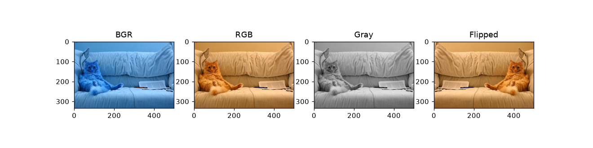
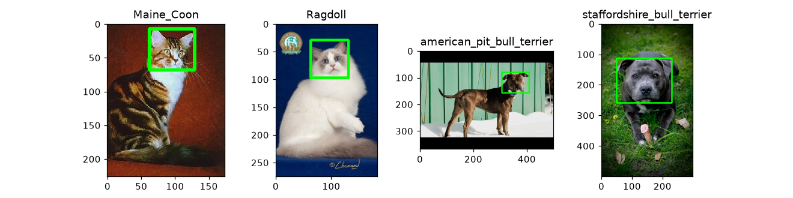

# Лабораторная 1: название

**Вариант:** 8

## 1. Задача

Ознакомиться с pandas, opencv и предоставленным датасетом.

## 2. Как запустить

Запускал в VSCode.

```bash
python -m venv .venv
source .venv/bin/activate
python -m pip install --upgrade pip
python -m pip install -r requirements.txt
# откройте solution.ipynb, впишите VARIANT и выполните Run All
```

## 3. Данные

```json
  "variant": 8,
  "breeds": [
    "Maine_Coon",
    "Ragdoll",
    "american_pit_bull_terrier",
    "staffordshire_bull_terrier"
  ],
```

## 4. Результаты

| Что | Значение |
| --- | --: |
| n_files | 799.0 |
| n_breeds | 4.0 |
| n_formats | 1.0 |
| n_non_jpeg | 0.0 |
| n_modes | 2.0 |
| n_non_rgb | 2.0 |
| n_with_xml | 405.0 |




## 5. Выводы

- Датасет содержит только jpeg файлы, все из которых кроме 2 идут в RGB. Для обучения не RGB изображения будут отфильтрованы, так как модель должны обучаться на нормализованных данных.
- 405 из 799 (51.189%) файлов имеют xml файл аннотации, и каждый из этих файлов содержит ровно один бокс головы.
- В BGR писксель имеет значение `[5, 27, 62]`, а в RGB `[62, 27, 5]`. `cvtColor` меняет синий и красный местами, возвращая кошке нормальный цвет за место синего, так как matplotlib предпологает изображения использует RGB.
