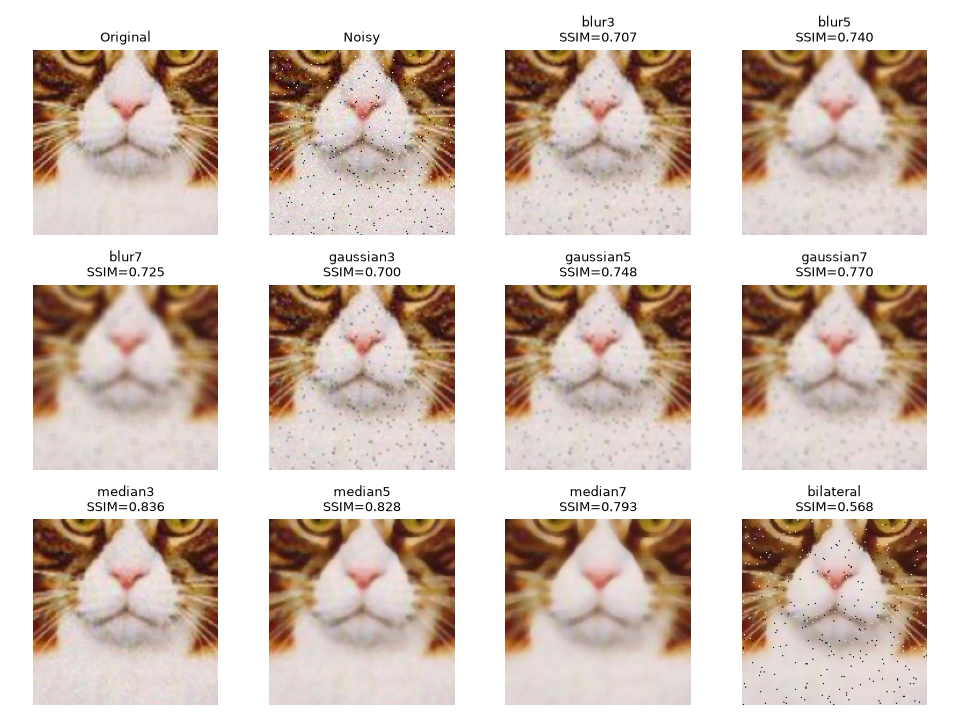
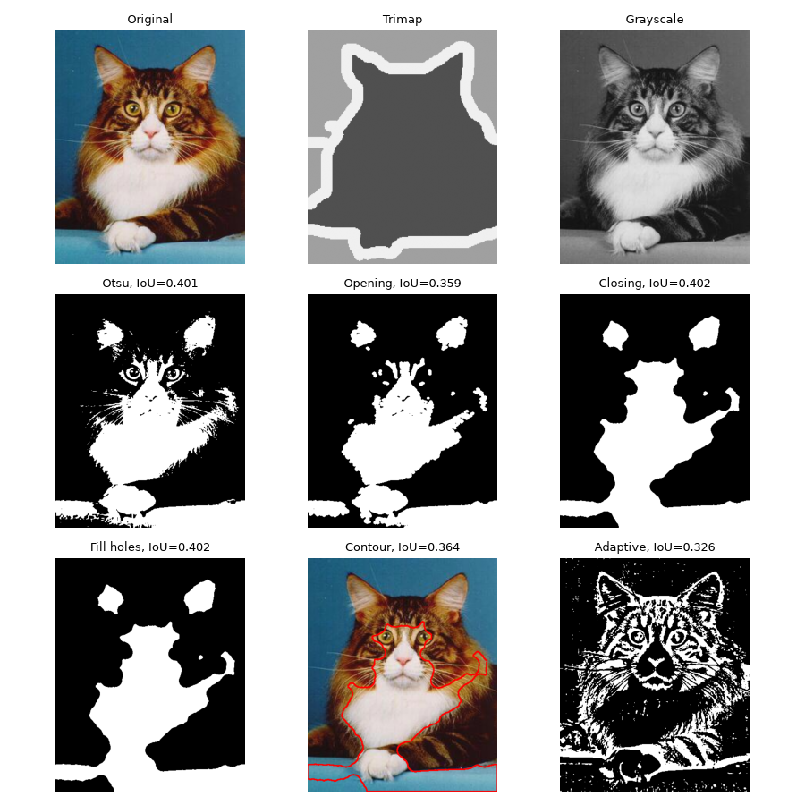
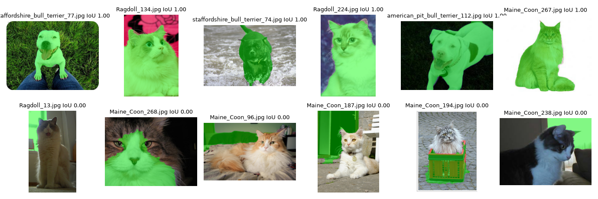

# Лабораторная 2: Классическая обработка: цвет, фильтры, пороги, морфология, контуры

**Вариант:** 8

## 1. Задача

Исследовать методы классической обработки изображений: оценить влияние шума и фильтров на качество фотографий, создать маски, выделяющие животных, и сравнить качество полученных масок с эталонной разметкой.

## 2. Как запустить

Запускал в VSCode.

```bash
python -m venv .venv
source .venv/bin/activate
python -m pip install --upgrade pip
python -m pip install -r requirements.txt
# откройте solution.ipynb, впишите VARIANT и выполните Run All
```

## 3. Данные

```json
  "variant": 8,
  "breeds": [
    "Maine_Coon",
    "Ragdoll",
    "american_pit_bull_terrier",
    "staffordshire_bull_terrier"
  ],
```

## 4. Результаты

| Что | Значение |
| --- | --: |
| BEST_FILTER | median3 |
| median3 PSNR | 31.9009 |
| median3 SSIM | 0.8355 |
| CHANNEL | gray |
| средняя IoU «только Оцу» | 0.307 |
| средняя IoU итоговая | 0.461 |





## 5. Выводы
- При добавлении шума в изображение лучшим оказался фильтр **median3**: его PSNR составил **31.90**, а SSIM — **0.84**. По сравнению со вторым по качеству фильтром (**median5**) разница составила **1.2 по PSNR** и **0.01 по SSIM**, что означает, что победивший фильтр лучше сохраняет исходное изображение при удалении шума.
- Победивший фильтр (**median3**) оказался самым быстрым. Он на **37%** быстрее второго по скорости фильтра (**gaussian3**), при этом обеспечивает лучшее качество.
- Самый большой прирост качества сегментации дала коррекция полярности: средняя IoU увеличилась на **0.103** - выбор правильной полярности позволяет выделить животное, а не фон. Применение фильтра практически не повлияло на результат: медианная IoU снизилась всего на **0.001** - применение фильтров не влияет на классическую сегментацию.
- Основная проблема худших масок заключается в контрастном окружении и контрастном животном: **Maine_Coon_194.jpg** маска выделяет красную корзину вместо кота, а на **Maine_Coon_268.jpg** - лишь белую часть окраски кота. Это показывает, что классическая сегментация по порогу Оцу плохо справляется с изображениями, где присутствуют контрастные объекты в окружении или часть животного отличается по контрасту.
